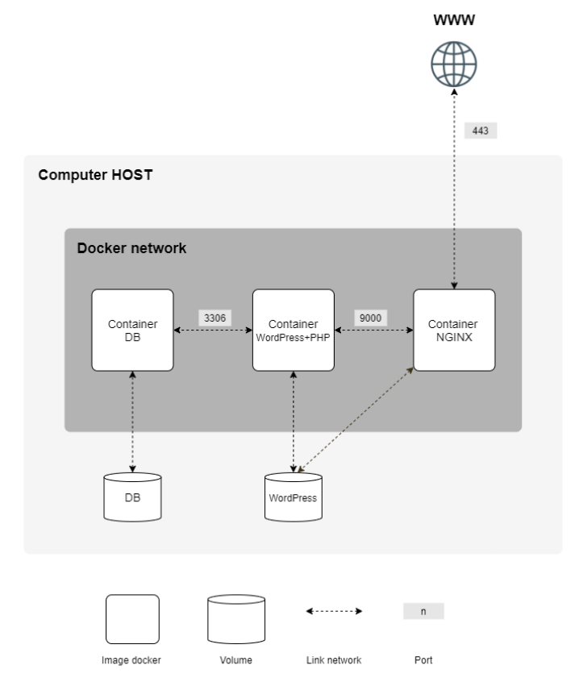

*This project has been created as part of the 42 curriculum by bboukach.*

# Inception

## Description

**Inception** is a system administration project. Its goal is to set up a small web infrastructure with **Docker Compose**, inside a virtual machine, following strict rules: every image is built from my own Dockerfiles, each service runs in its own container, and the whole stack is started with a single `make`.

The infrastructure serves a **WordPress** website over HTTPS:



- **nginx** is the only entry point, on port 443, with TLSv1.2 or TLSv1.3 only.
- **wordpress** runs WordPress with php-fpm, without a web server.
- **mariadb** runs the database, without a web server.
- Two **named volumes** store the database and the website files in `/home/bboukach/data`.
- A dedicated **Docker network** connects the containers.

The **bonus part** adds five services, started only with `make bonus`:

| Service | Role | Access |
|---|---|---|
| **website** | Static showcase site (HTML/CSS, no PHP) served by its own nginx | `http://bboukach.42.fr:8080` |
| **adminer** | Web interface to manage the MariaDB database | `http://127.0.0.1:8081` (VM only) |
| **redis** | Object cache for WordPress | Internal only |
| **ftp** | vsftpd server giving access to the WordPress volume | `ftp://127.0.0.1:21` (VM only) |
| **backup** | Daily backup of the database and the WordPress files, with restore script | Internal only |

### Use of Docker and sources included in the project

Each service is described by a **Dockerfile** built from `debian:bookworm` (the penultimate stable Debian release). No ready-made image is pulled, apart from the Debian base image. `docker-compose.yml` describes how the images are built and connected: network, volumes, secrets, restart policy and profiles. The `Makefile` wraps the Compose commands.

```
Makefile                         build / start / stop / clean the stack
srcs/docker-compose.yml          services, network, volumes, secrets
srcs/.env.example                template for the non-secret configuration
srcs/requirements/<service>/     mandatory services: mariadb, wordpress, nginx
srcs/requirements/bonus/<service>/   bonus services: website, adminer, redis, ftp, backup
    Dockerfile                   how the image is built
    .dockerignore                files excluded from the build context
    conf/                        configuration file copied into the image
    tools/                       setup script, run as the container's entrypoint
```

### Main design choices

**Mandatory part**

- **One setup script per service, run at container start.** Tools are installed in the Dockerfile, whereas data and secrets are handled by the script at runtime. A mounted volume hides the image content, and secrets only exist when the container runs.
- **Idempotent first start.** Each script checks a *witness file* (`wp-config.php`, the database folder, `cert.pem`) and only performs the installation once. Later starts go straight to the service.
- **The service is PID 1.** Each script ends with `exec`, which replaces the shell with the service running in the foreground (`mariadbd`, `php-fpm8.2 -F`, `nginx -g "daemon off;"`). There is no `tail -f`, no `sleep infinity` and no infinite loop. The waiting loops are bounded to 30 tries.
- **Fail early and clearly.** Every script uses `set -e` and checks its variables, and refuses an administrator name containing `admin`. A misconfigured container stops with an explicit message in `docker logs`.
- **WordPress is installed with WP-CLI** (`wp core download`, `config create`, `core install`, `user create`).
- **The TLS certificate is self-signed and generated at runtime.** The private key is never stored in the image.
- **Least privilege.** Each container only receives the secrets and variables it needs (nginx receives no secret), and services drop root privileges (`mysql`, `www-data`).
- **Images are tagged `:inception`** to avoid the forbidden `latest` tag.
- **A network alias** makes `bboukach.42.fr` resolve to nginx inside the Docker network, so that WordPress loopback requests (REST API, WP-Cron) work.
- **PHP extensions:** `gd`, `curl`, `xml`, `mbstring`, `zip`, `intl` (and `redis` for the bonus) are installed. `imagick` is left out on purpose, since `gd` already handles images and `imagick` would add a much heavier dependency.
- **The nginx image is emptied of Debian's welcome page.** Docker copies the image content into an empty named volume the first time it is mounted, so that page could otherwise end up in the WordPress volume.

**Bonus part**

- **Compose profiles keep the mandatory part untouched.** Bonus services have `profiles: ["bonus"]`: `make` starts the 3 mandatory containers, `make bonus` starts all 8.
- **website** has its own nginx on port 8080. Routing it through the main nginx would break the mandatory part: nginx resolves upstream names at startup and would refuse to start without the `website` container. The site files are copied into the image (static code, no volume needed).
- **adminer** runs PHP's built-in server (`php -S`): one file, one process, enough for a single-user admin tool. It runs as `www-data`, its port is published on `127.0.0.1` only because database passwords travel in clear HTTP, and `init: true` is used because `php -S` ignores `SIGTERM` when it is PID 1 (the kernel ignores unhandled signals for PID 1).
- **redis** is configured as a pure cache: no persistence, 64 MB limit, LRU eviction, reachable only inside the Docker network. The WordPress script checks at **every start** whether the `redis` container exists, and enables or disables the cache accordingly (the `object-cache.php` drop-in is removed directly, since any `wp` command loads it).
- **ftp** uses vsftpd in passive mode (ports 21 and 21100-21110, published on `127.0.0.1` only, since FTP is unencrypted). The FTP user is chrooted in the WordPress volume and shares UID 33 with `www-data`, so uploaded files are directly usable by php-fpm and nginx.
- **backup** runs `cron -f` as PID 1 (a real scheduler in the foreground, not a loop). The job exports the database with `mariadb-dump` and archives the WordPress volume (mounted read-only) every day, keeping the 7 most recent backups. Since cron jobs get an almost empty environment, the setup script saves the needed values in a file read by the job.

### Virtual Machines vs Docker

| | Virtual machine | Docker container |
|---|---|---|
| What it is | A full computer emulated by a hypervisor, with its **own kernel** and operating system | An **isolated process** of the host, sharing the host kernel |
| Isolation | Strong (hardware-level) | Lighter: namespaces (what the process sees) and cgroups (what it can use) |
| Size / start time | Gigabytes, boots in tens of seconds or minutes | Megabytes, starts in about a second |
| Typical use | Run a different OS, strong isolation | Package one service with its dependencies, reproducibly |

In this project both are used: the VM (Debian 13) is the host, and Docker runs the services on it. For example, the containers are built from Debian 12 but report the Debian 13 kernel of the VM, because the kernel is shared.

### Secrets vs Environment Variables

| | Environment variables | Docker secrets |
|---|---|---|
| How they are passed | Variables in the process environment | Files mounted read-only at `/run/secrets/<name>` |
| Visibility | Shown by `docker inspect`, inherited by every child process, often leaked in logs | Not shown by `docker inspect`; only in the containers that declare them |
| Good for | Non-sensitive configuration (domain, usernames) | Passwords, keys |

In this project, non-sensitive settings are in `srcs/.env`, and the five passwords are Docker secrets read by the scripts with `cat /run/secrets/...`. With Compose (outside of Swarm), a secret is a file of the host mounted into the container. The source files must therefore be protected (`chmod 600`) and ignored by Git.

### Docker Network vs Host Network

| | User-defined Docker network (bridge) | Host network |
|---|---|---|
| Isolation | Containers get their own private network | The container shares the host's network stack |
| Name resolution | Built-in DNS: containers reach each other by service name (`mariadb`, `wordpress`) | None |
| Exposure | Only explicitly published ports are reachable from the host | Every port the service opens is directly on the host |

In this project, the containers are on the bridge network `inception`. In the mandatory part, only nginx publishes a port (`443:443`); MariaDB (3306) and php-fpm (9000) are reachable only inside the network. The bonus publishes 8080 (website), and 8081, 21 and 21100-21110 on `127.0.0.1` only (adminer, ftp). Redis (6379) stays internal. `network: host` and `links` are forbidden by the subject.

### Docker Volumes vs Bind Mounts

| | Named volume | Bind mount |
|---|---|---|
| Declared | In the `volumes:` section, referenced by name | As a host path directly in the service |
| Managed by Docker | Yes: `docker volume ls`, `inspect`, `rm` | No, it is just a host folder |
| Portability | Independent from the host layout | Depends on a specific host path |

The subject requires named volumes whose data ends up in `/home/bboukach/data`. The volumes `db_data`, `wp_data` (and `backup_data` for the bonus) are therefore named volumes using the `local` driver with `driver_opts` (`type: none`, `o: bind`, `device: /home/bboukach/data/...`). They remain Docker-managed volumes; these options only choose **where** the driver stores the data.

## Instructions

### Prerequisites

A Debian VM with Docker Engine, the Docker Compose plugin, `make` and `sudo` rights. The full setup (installation commands included) is described in [DEV_DOC.md](DEV_DOC.md).

### Configuration

```bash
cp srcs/.env.example srcs/.env          # then edit the values
mkdir -p secrets
echo 'password' > secrets/db_password.txt
echo 'password' > secrets/db_root_password.txt
echo 'password' > secrets/wp_admin_password.txt
echo 'password' > secrets/wp_user_password.txt
echo 'password' > secrets/ftp_password.txt          # bonus only
chmod 600 secrets/*.txt
echo '127.0.0.1   bboukach.42.fr' | sudo tee -a /etc/hosts
```

### Build and run

```bash
make            # mandatory part: build the images and start the 3 services
make bonus      # mandatory + bonus: start the 8 services
make ps         # check the containers
```

Then open <https://bboukach.42.fr> (accept the self-signed certificate) and log in at `/wp-admin`.

| Rule | Effect |
|---|---|
| `make` | Build and start the mandatory part |
| `make bonus` | Build and start everything, bonus included |
| `make stop` / `make start` | Pause / resume the containers |
| `make down` | Remove the containers (data kept) |
| `make fclean` | Remove everything, data and backups included |
| `make re` | Full reinstall of the mandatory part |
| `make logs` | Show the logs |

Day-to-day usage is described in [USER_DOC.md](USER_DOC.md).

## Resources

### Documentation

- [Docker: Dockerfile reference](https://docs.docker.com/reference/dockerfile/)
- [Docker: Building best practices](https://docs.docker.com/build/building/best-practices/)
- [Docker: Compose file reference](https://docs.docker.com/reference/compose-file/)
- [Docker: Secrets in Compose](https://docs.docker.com/compose/how-tos/use-secrets/)
- [Docker: Use service profiles](https://docs.docker.com/compose/how-tos/profiles/)
- [Docker: Volumes](https://docs.docker.com/engine/storage/volumes/) and [Bind mounts](https://docs.docker.com/engine/storage/bind-mounts/)
- [Docker: Bridge network driver](https://docs.docker.com/engine/network/drivers/bridge/)
- [Docker: Install Docker Engine on Debian](https://docs.docker.com/engine/install/debian/)
- [nginx: ngx_http_ssl_module](https://nginx.org/en/docs/http/ngx_http_ssl_module.html)
- [nginx: ngx_http_fastcgi_module](https://nginx.org/en/docs/http/ngx_http_fastcgi_module.html)
- [PHP: FastCGI Process Manager configuration](https://www.php.net/manual/en/install.fpm.configuration.php)
- [PHP: Built-in web server](https://www.php.net/manual/en/features.commandline.webserver.php)
- [WP-CLI commands](https://developer.wordpress.org/cli/commands/)
- [WordPress hosting handbook: server environment](https://make.wordpress.org/hosting/handbook/handbook/server-environment/)
- [Redis Object Cache plugin](https://wordpress.org/plugins/redis-cache/)
- [Adminer](https://www.adminer.org/)
- [vsftpd configuration options](https://security.appspot.com/vsftpd/vsftpd_conf.html)
- [MariaDB documentation](https://mariadb.com/docs/)
- Various YouTube videos

### Use of AI

I used an AI assistant (Claude Opus 5.5) as a **tutor** throughout the project. It helped me to translate, to understand concepts deeply, to correct syntax (shell scripts, Markdown), to find edge cases that I was missing, and to debug.